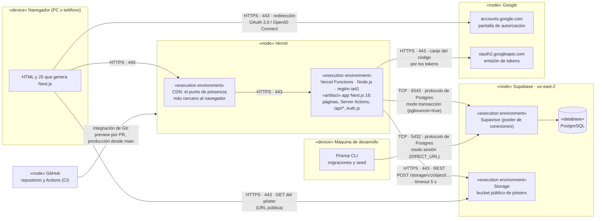

# Diagrama de despliegue

Dónde corre cada parte del sistema en producción y cómo se comunican, con protocolo y puerto. Es
la fuente común para citar en los informes: si cambia la infraestructura, se actualiza acá.

Todo lo que dice este documento sale del código y de la configuración del repositorio, o de
mirar producción (03/11/2026). Al lado de cada dato está de dónde sale.

## Conexiones

| Desde | Hacia | Protocolo y puerto | Credencial | De dónde sale |
|---|---|---|---|---|
| Navegador | Vercel | HTTPS, 443 | Cookie de sesión de Auth.js (JWT cifrado con `AUTH_SECRET`) | `lib/auth.ts` (`strategy: "jwt"`), ADR 0004 |
| App (Vercel) | Postgres | TCP 6543, protocolo de Postgres, a través del pooler en modo transacción | Usuario y contraseña en `DATABASE_URL` | `prisma/schema.prisma` (`url`), `.env.example`; host y puerto, de la variable configurada |
| Prisma CLI (desarrollo) | Postgres | TCP 5432, protocolo de Postgres, a través del pooler en modo sesión | Usuario y contraseña en `DIRECT_URL` | `prisma/schema.prisma` (`directUrl`): las migraciones necesitan una conexión de sesión, que el modo transacción no da |
| App (Vercel) | Supabase Storage | HTTPS, 443, API REST | `Authorization: Bearer` con `SUPABASE_SERVICE_ROLE_KEY`, solo en el servidor | `lib/servicios/storage.ts` (`subirImagen`), con timeout de 5 s |
| Navegador | Supabase Storage | HTTPS, 443, `GET` | Ninguna: el bucket es público | La URL `/storage/v1/object/public/…` que devuelve `subirImagen` |
| Navegador | Google | HTTPS, 443, redirección de OAuth 2.0 / OpenID Connect | La cuenta de Google de la persona | Proveedor `Google` en `lib/auth.ts`, ADR 0003 |
| App (Vercel) | Google | HTTPS, 443, canje del código de autorización por los tokens | `AUTH_GOOGLE_ID` y `AUTH_GOOGLE_SECRET` | Proveedor `Google` en `lib/auth.ts` (Auth.js hace el canje) |
| GitHub | Vercel | Integración de Git de Vercel | La de la integración, fuera del repo | Los checks `Vercel` y `Vercel Preview Comments` de cada PR |
| GitHub Actions | — | — | Ninguna: no se conecta a la base ni a Vercel | `.github/workflows/ci.yml`: audit, typecheck, lint y tests |

## Notas

- **Regiones.** La función corre en `iad1` (Washington D.C.), según el header `x-vercel-id` de
  una respuesta de producción (`gru1::iad1::…`: el primer tramo es el punto de presencia que
  atendió al navegador, el último la región de la función). La base está en `us-east-2` (Ohio),
  según el host del pooler.
- **Por qué dos puertos para la misma base.** La app corre en funciones que se crean y se
  destruyen: abrir una conexión de Postgres por request agotaría las conexiones. Por eso pasa por
  el pooler en modo transacción (6543). Las migraciones, en cambio, necesitan una conexión de
  sesión, y van por el 5432.
- **Las credenciales viven en variables de entorno**: en Vercel para producción y previews, y en
  `.env.local` para desarrollo. Ninguna lleva el prefijo `NEXT_PUBLIC_`, así que ninguna llega al
  navegador (`AGENTS.md`, Seguridad). La lista completa está en `.env.example`.
- **El pago no aparece en el diagrama** porque no sale de la app: `lib/pagos.ts` es un mock en
  memoria. El día que sea una pasarela real, va a ser otra conexión HTTPS desde la función
  (`AGENTS.md`, Servicios externos).
- **Desarrollo y producción comparten la base.** Correr el seed o probar compras en local deja
  datos en producción (ver el README).
